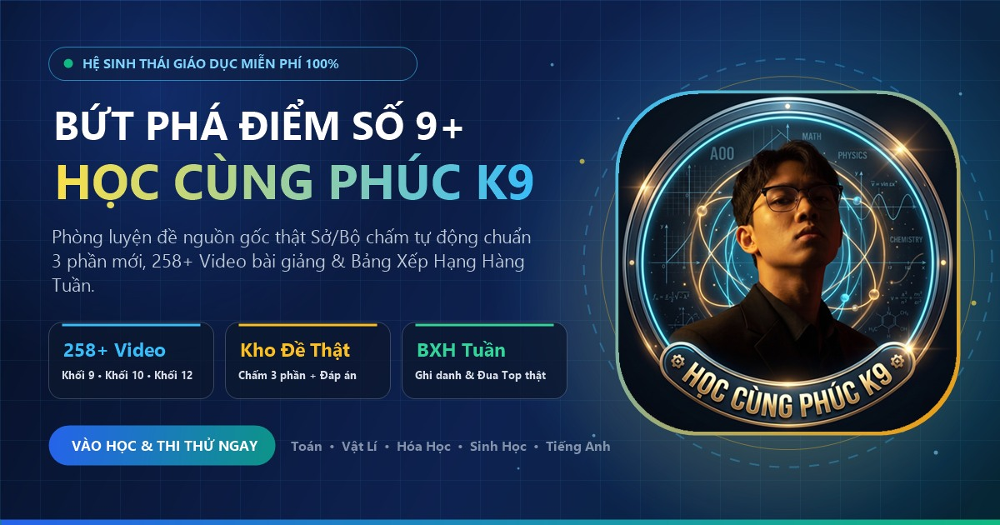

<div align="center">


# HỌC CÙNG PHÚC K9
### Hệ Sinh Thái Luyện Thi 9+ • Video Bài Giảng Đa Môn • Kho Đề Nguồn Thật • BXH Học Viên

[](https://thanhphuc.vercel.app/)
[](https://thanhphuc.vercel.app/)
[](./LICENSE)

<br/>

<a href="https://thanhphuc.vercel.app/">
  
</a>

**[Vào Học Miễn Phí Ngay tại https://thanhphuc.vercel.app/](https://thanhphuc.vercel.app/)**

</div>

---

## Giới thiệu — Học Cùng Phúc K9 là gì?

**HỌC CÙNG PHÚC K9** (*hoc cung phuc k9*) là nền tảng web học tập & ôn thi miễn phí chuẩn chương trình **GDPT 2018**, thiết kế tối ưu cho cả **PC và Điện thoại (PWA)**, giúp học sinh hệ thống lại kiến thức, luyện đề chuẩn nguồn thật và thi đua học tập mỗi tuần.

### Tính năng nổi bật
- **258+ Video Bài Giảng phân tầng rõ theo Khối & Môn học**: Chia rành mạch theo từng cấp/môn (**Ôn vào lớp 10**, **Toán**, **Vật Lí**, **Hóa Học**, **Sinh Học**, **Tiếng Anh**, **Khối 10**), mỗi bài giảng đi kèm video YouTube chất lượng và tiến độ học tập.
- **Kho Luyện Đề Nguồn Gốc Thật (Sở GD / Bộ GD)**: Tích hợp đề thi thật, đồng hồ đếm ngược, **chấm điểm tự động**, xem đáp án chi tiết và phân tích điểm mạnh/yếu theo từng chuyên đề.
- **Bảng Xếp Hạng (BXH) Hàng Tuần & Top Học Viên**: Ghi nhận XP thực từ kết quả làm đề và hoàn thành video bài giảng khi học viên đăng ký tài khoản.
- **Tìm kiếm nhanh (`Ctrl + K`) & Cài đặt như App (PWA)**: Hỗ trợ offline cơ bản qua Service Worker ([sw.js](./sw.js)) và biểu tượng App riêng.
- **Xem trước link chuẩn Zalo / Facebook / Telegram**: Hỗ trợ đầy đủ Open Graph banner & meta động qua [api/og-meta.js](./api/og-meta.js).

---

## Cấu trúc chính của dự án

| Thành phần | Mô tả |
| --- | --- |
| [index.html](./index.html) | Giao diện chính, SEO metadata, Open Graph, PWA manifest & Schema JSON-LD |
| [style.css](./style.css) | Hệ thống giao diện responsive PC & Mobile |
| [assets/pk9-curriculum.js](./assets/pk9-curriculum.js) | Dữ liệu lộ trình 258+ bài giảng phân loại theo khối & môn |
| [assets/exam-center.js](./assets/exam-center.js) | Phòng luyện đề & hiển thị kết quả/chấm điểm |
| [assets/pk9-app.js](./assets/pk9-app.js) | Điều hướng, tài khoản học viên, tiến độ & Bảng xếp hạng |
| [api/](./api/) | Serverless API Vercel (Auth, Exams, Leaderboard, Dashboard, Community, AI, OG Meta) |
| [lib/](./lib/) | Kết nối Upstash Redis, xử lý đề thi & xác thực người dùng |
| [server.js](./server.js) | HTTP Server cục bộ để chạy thử & phát triển offline |

---

## Chạy thử trên máy cá nhân (Local)

Yêu cầu: **Node.js >= 18**.

```bash
# 1. Tải mã nguồn
git clone <link-repo-cua-ban>
cd phuc-k9-web

# 2. Cài thư viện
npm install

# 3. Tạo file biến môi trường (tùy chọn nếu dùng Redis / AI / Blob)
cp env.example .env

# 4. Khởi chạy server local
npm start
```

Mở trình duyệt tại `http://localhost:3000`.

---

## Deploy lên Vercel

Dự án sẵn sàng chạy **Static + Serverless Functions** trên Vercel:
- Cấu hình header & bot preview rewrite nằm trong [vercel.json](./vercel.json).
- Nếu dùng lưu tài khoản & Bảng xếp hạng trực tuyến, thiết lập các biến môi trường trong `env.example` (như `UPSTASH_REDIS_REST_URL`, `UPSTASH_REDIS_REST_TOKEN`) trên Vercel Dashboard.
- Tham khảo thêm tại [README-VERCEL.md](./README-VERCEL.md).

---

## Góp ý & Báo lỗi đề thi

Nếu phát hiện câu hỏi sai đáp án, video bị lỗi hoặc muốn đề xuất thêm đề mới cho **HỌC CÙNG PHÚC K9**, bạn có thể mở một **Issue** mới trên GitHub theo mẫu có sẵn trong mục **Issues**.

---

<div align="center">
  Phát triển cho cộng đồng học sinh Việt Nam • <b>HỌC CÙNG PHÚC K9</b> • <a href="https://thanhphuc.vercel.app/">https://thanhphuc.vercel.app/</a>
</div>
